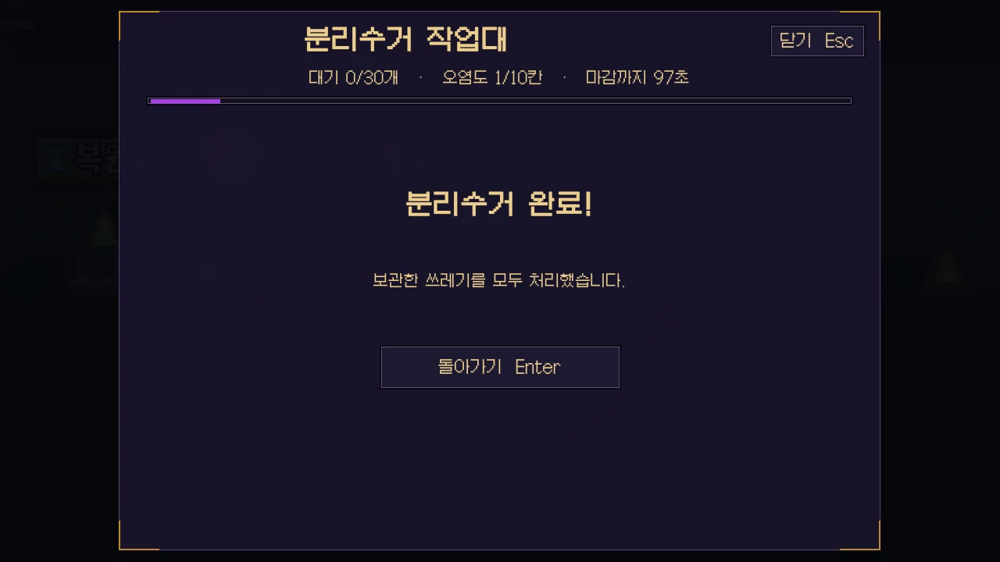

# 쓰레기 집게 소년

**지하를 탐험하며 쓰레기를 모으고, 분리수거 판정과 보상을 통해 하루의 목표를 채우는 게임입니다.**

4인 팀 · 개발 완료 · 탐험·수집·분리수거 · Unity 6000.3.10f1 · C#

[Windows 실행 파일](https://github.com/lde0707/portfolio-game-builds/releases/tag/trashboy-2026-11-14-r2) · [QA 엑셀](https://leedoeon.vercel.app/qa/reports/trash-boy.xlsx) · [QA 포트폴리오](https://leedoeon.vercel.app/qa/index.html)

## 내가 맡은 역할

콘셉트·플레이 흐름 기획과 시스템 설계를 담당했습니다.

## 게임의 주요 흐름

타이틀 → 이동·채굴 → 수집·맡기기 → 분리수거

## 실행 방법

### Unity 없이 플레이

1. 위 **Windows 실행 파일** 링크에서 `TrashBoy-Windows-x64.zip`을 받습니다.
2. ZIP **전체를 압축 해제**합니다.
3. `TrashBoy.exe`를 실행합니다.

Windows 64비트용입니다. EXE와 `Data` 폴더·`UnityPlayer.dll`을 함께 유지하세요. GitHub의 `Source code` 압축 파일은 게임 실행 패키지가 아닙니다.

**기본 조작:** A·D 이동 / W·S 지상·지하 이동 / Space 채굴·점프 / E 맡기기 / F 분리수거 / 1~5 분류 / Esc 메뉴

Unity에서 소스 열기

1. Unity Hub에서 `Capstone` 폴더를 프로젝트로 추가합니다.
2. **Unity 6000.3.10f1**으로 엽니다.
3. `Assets/Scenes/SampleScene.unity` 씬을 열고 Play를 실행합니다.
4. 실행 파일을 만들 때 Windows Build Support를 설치하고 기존 Build Settings의 씬 구성으로 Windows x64를 빌드합니다.

## QA 테스트

Windows 빌드에 실제 키보드·마우스 입력을 보내 확인한 내용입니다. 세부 조건과 관찰값은 **QA 엑셀의 플레이 재검증 시트**에서 볼 수 있습니다.

| 확인 기능 | 테스트 조건 | 관찰 결과 |
|---|---|---|
| 게임 시작 안정성 | 별도 실행 옵션 없이 시작 | D3D11 빌드에서 수집·분리수거까지 진행 |
| 수집·맡기기 | 채굴 후 작업대에 맡기기 | 소지품 비움과 작업 대기열 반영 |
| 분류 판정 | 정답·오답·시간 초과 각각 확인 | 정답 보상 지급, 오분류·시간 초과 시 오염도 증가 |

### 결함 수정 후 재검증

게임 시작 후 Direct3D 12 렌더러에서 종료되는 문제를 확인했습니다. Windows 그래픽 API를 Direct3D 11로 지정해 재빌드한 뒤 수집·맡기기·분류·보상을 재검증했습니다.

**검증 범위:** Direct3D 11로 수정한 빌드에서 확인했습니다. 다른 GPU·장시간 플레이·모든 날짜의 정산은 이번 범위에서 제외했습니다.

[실제 입력 검증 기록](PLAYTEST.md) · [실행·검증 안내](PLAY.md)

## 소스와 상세 문서

- [월드 표시](Capstone/Assets/Scripts/DigGame/World/WorldView.cs)
- [장비·플레이어 설정](Capstone/Assets/Scripts/DigGame/Player/PlayerGear.cs)
- [기존 개발·설계 기록](README-DEV-NOTES.md)
